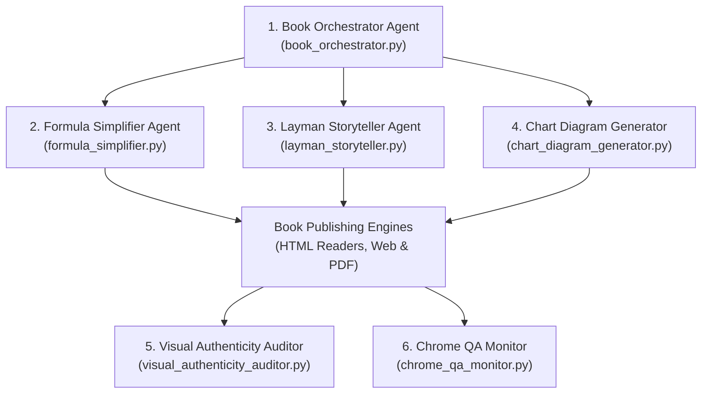

# 🤖 Tantra Gyan Multi-Agent Publishing Suite
## Google Antigravity SDK Architecture for Flagship Book Generation

The **Tantra Gyan Multi-Agent Publishing Suite** automates the end-to-end transformation of dense astronomical and astrological mathematical engines into world-class digital and print books.

---

## 🏗️ Architecture & Agent Roles



### 1. `BookOrchestratorAgent` (`book_orchestrator.py`)
- **Role:** High-level executive planner and DAG task orchestrator.
- **Responsibilities:** Ingests the 13 raw mathematical calculation modules from `vedic-astrology-kundali-studio`, constructs the table of contents, sequences subtasks, and tracks pipeline status.

### 2. `FormulaSimplifierAgent` (`formula_simplifier.py`)
- **Role:** Mathematical deconstructor and arithmetic translator.
- **Responsibilities:** Converts complex astronomical equations (e.g. Julian Day, RAMC, Ayanamsha, Kakshyas) into elementary school step-by-step arithmetic without confusing notation.

### 3. `LaymanStorytellerAgent` (`layman_storyteller.py`)
- **Role:** Narrative humanizer and parable crafter.
- **Responsibilities:** Enforces the **6-Part Formula Structure**: real-world parables, plain-words rules, point-to-point explanations, worked examples, and life takeaways. Guarantees zero AI disclaimers and zero robotic tone.

### 4. `ChartDiagramGeneratorAgent` (`chart_diagram_generator.py`)
- **Role:** Visual cartographer and vector designer.
- **Responsibilities:** Synthesizes responsive, high-contrast SVG diagrams, North Indian Kundali diamond charts, and comparison matrices with theme colors (Royal Emerald `#059669` and Celestial Cyan `#0284c7`).

### 5. `VisualAuthenticityAuditorAgent` (`visual_authenticity_auditor.py`)
- **Role:** Design standards enforcer (Impeccable engine integration).
- **Responsibilities:** Audits generated markup to ensure zero generic AI tropes (no blurry neon glow, no radioactive borders), high contrast, and classical manuscript typography.

### 6. `ChromeQAMonitorAgent` (`chrome_qa_monitor.py`)
- **Role:** Browser QA inspector and frontend verifier.
- **Responsibilities:** Inspects rendered HTML for viewport responsiveness, encoding integrity, missing image paths, anchor validation, and accessibility (a11y) standards.

---

## 🚀 CLI Usage

Run the master agent pipeline from the repository root:

```bash
# Run all agents in sequence
python3 agents/run_book_agents.py --all

# View orchestrator chapter planning
python3 agents/run_book_agents.py --plan

# Run visual authenticity detection
python3 agents/run_book_agents.py --audit

# Run Chrome QA checks on reader pages
python3 agents/run_book_agents.py --qa
```
